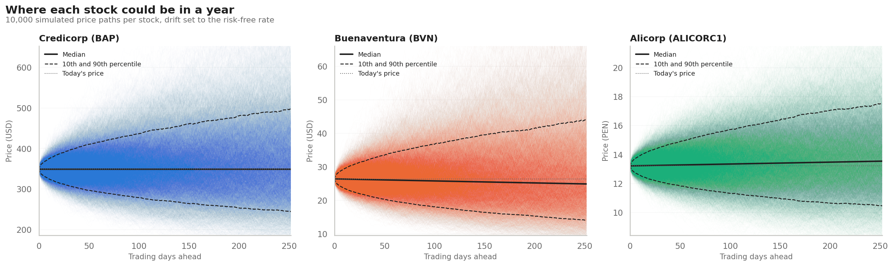
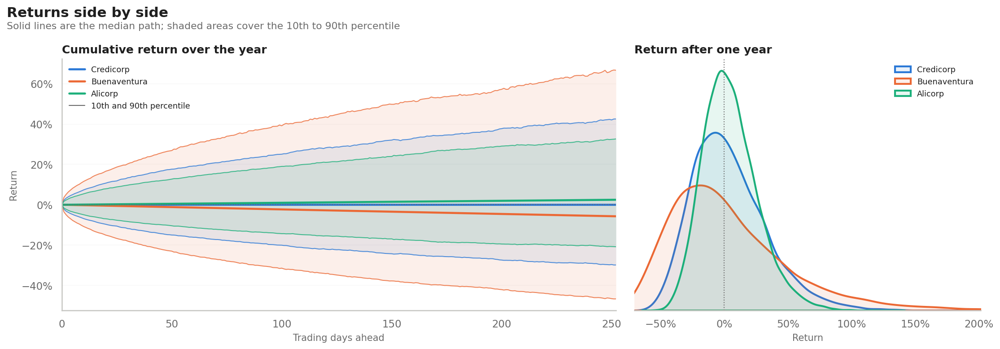
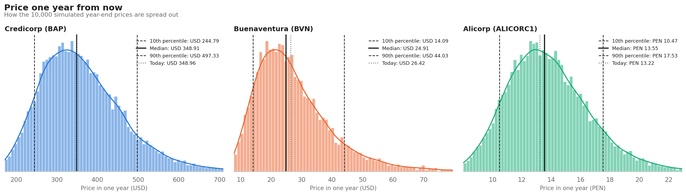

# How risky are Peru's flagship stocks? A Monte Carlo look

[](https://colab.research.google.com/github/matteoriggi07-lang/peru-equities-monte-carlo/blob/main/peru_monte_carlo.ipynb)

I'm a Peruvian student studying business abroad, and I'm interested in finance. I wanted to apply what I've been learning to my own country's market instead of the usual US stocks everyone analyses. So I picked three companies most Peruvians know, from three very different parts of the economy, and asked a simple question: how much could each of them realistically gain or lose over the next year?

To answer it, I simulated 10,000 possible one-year price paths for each one:

| Company | Ticker | Sector | Listed on |
|---|---|---|---|
| Credicorp | BAP | Banking | NYSE (USD) |
| Compañía de Minas Buenaventura | BVN | Gold and copper mining | NYSE (USD) |
| Alicorp | ALICORC1 | Consumer goods | Lima Stock Exchange (PEN) |

Everything runs in one notebook. Open it in Colab with the badge above to rerun it with the latest prices.



## Results

Based on daily prices from November 2023 to October 2026, with the drift set to the risk-free rate:

| | Credicorp | Buenaventura | Alicorp |
|---|---|---|---|
| Annual volatility | 28.2% | 44.4% | 20.3% |
| Bad year (10th percentile) | -29.9% | -46.7% | -20.8% |
| Good year (90th percentile) | +42.5% | +66.7% | +32.6% |
| VaR 95% (one year) | 36.7% | 55.1% | 26.6% |
| Expected shortfall 95% | 43.3% | 62.4% | 32.5% |
| Chance of ending higher | 50% | 45% | 55% |

Buenaventura is the riskiest of the three by a wide margin. In the worst 5% of scenarios it loses at least 55% of its value, which makes sense for a miner whose profits follow gold and copper prices. Alicorp, which sells food and household products, has less than half its volatility. Credicorp lands in between, though its range of outcomes is much closer to Alicorp's than to Buenaventura's.

The biggest lesson for me was how much the drift assumption matters. If I let the model assume the last three years' trend continues (+44% a year for Credicorp, +51% for Buenaventura, +35% for Alicorp), it gives all three an 82–95% chance of rising, which isn't believable. So the main results use the risk-free rate instead, and the notebook shows the other assumptions side by side.



## Method

Prices come from Yahoo Finance, adjusted for dividends and splits. New York and Lima have different holidays, so each stock's daily returns are calculated on its own trading days only. Volatility is annualised from three years of daily log returns.

Each stock follows a geometric Brownian motion:

```math
S_T = S_0 \exp\left(\left(\mu - \tfrac{\sigma^2}{2}\right)T + \sigma\sqrt{T}\,Z\right)
```

It's simulated over 252 daily steps with 10,000 paths (using antithetic sampling to reduce noise). The drift μ is the risk-free rate of each stock's currency: the 13-week US T-bill for the dollar stocks, and 4.5% for soles, which I set by hand.

From the simulated year-end prices I take the 10th, 50th and 90th percentiles, the 95% Value at Risk and expected shortfall, and the share of paths that finish above today's price.



## Limitations

The model assumes returns follow a normal distribution, and a Jarque-Bera test rejects that for all three stocks. Real returns have more extreme days, so the true downside is probably worse than shown. Volatility is also held constant, while in reality it jumps during crises. Each stock is simulated on its own, so this says nothing about how they move together in a portfolio. Finally, Alicorp is priced in soles and the others in dollars, so compare percentages rather than prices.

This is a learning project, not investment advice.

## Running it

In Colab, choose **Runtime → Run all**. Everything it needs is already installed. Charts and a `summary.csv` are saved to a `figures/` folder. To run it on your own machine, install the libraries first:

```bash
pip install yfinance matplotlib seaborn pandas numpy scipy
```

The settings at the top of the notebook control the tickers, number of paths, horizon and drift assumption.

## Author

Matteo Origgi, BBA student at IE University.
